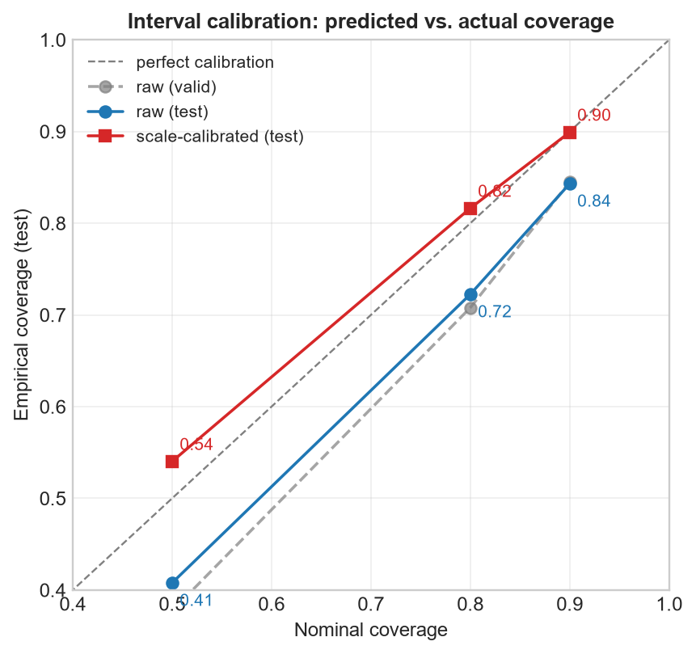
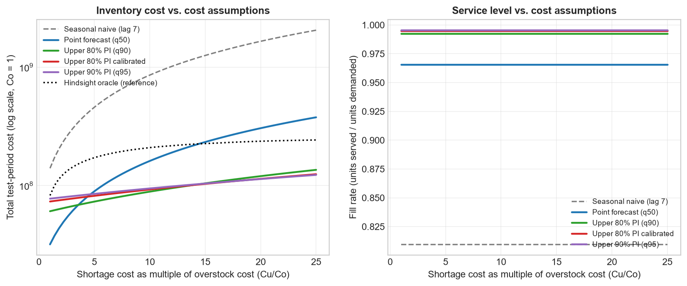
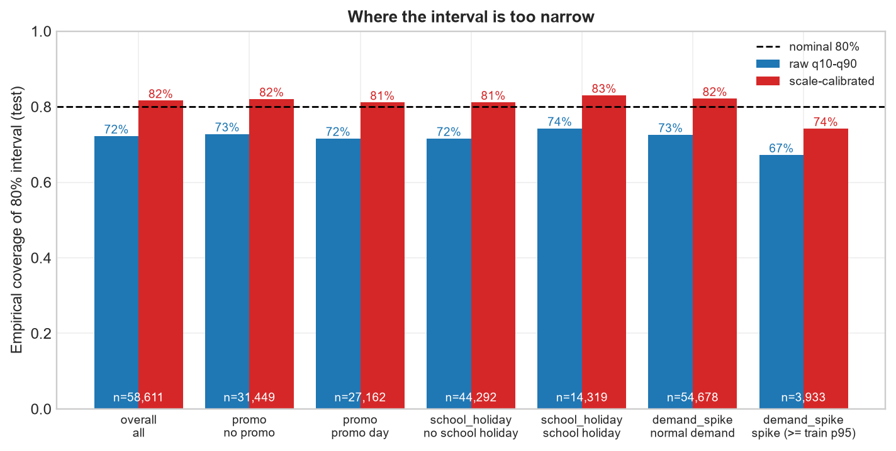
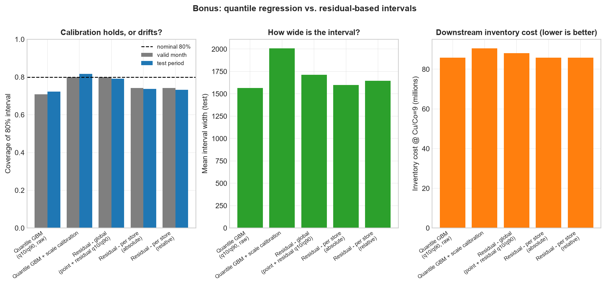

# Demand Forecasting with Uncertainty Quantification

Retail demand forecasts for 1,115 stores — with **calibrated prediction
intervals**, not just point estimates, and an explicit link from the interval
to an **inventory (safety-stock) decision**.

> **Round 2 · AIML-04** — Build a forecasting model that outputs prediction
> intervals, use them to inform an inventory decision, evaluate both point
> accuracy and interval calibration, and analyse where the model is
> overconfident.

---

## Contents

- [Scenario](#scenario)
- [Dataset](#dataset)
- [Approach](#approach)
- [Results](#results)
- [Setup](#setup)
- [Reproduce / re-run evaluation](#reproduce--re-run-evaluation)
- [Repository structure](#repository-structure)
- [Key decisions & trade-offs](#key-decisions--trade-offs)
- [Limitations & next steps](#limitations--next-steps)

---

## Scenario

A retailer plans inventory from a demand forecast. A single point forecast
hides risk: ordering on the mean leaves ~half of all store-days short, while
ordering on the 95th percentile all the time wastes stock. The business needs
the *confidence* of the forecast — a distribution — not just its centre.

**What this project delivers**

1. Gradient-boosted quantile forecasts (10th/50th/90th percentile, plus
   5/25/75/95 for calibration curves).
2. Prediction intervals checked against their **nominal coverage**, plus a
   light calibration step fitted on a validation month.
3. A newsvendor-style inventory simulation: order on the upper bound of the
   interval vs. order on the point forecast, across cost assumptions.
4. An overconfidence audit: where do intervals go too narrow (promotions,
   demand spikes, specific stores/weeks)?

## Dataset

**Rossmann Store Sales** — 1,017,209 daily sales rows × 1,115 stores,
2013-01-01 → 2015-07-31, with promotion flags (`Promo`, `Promo2`) and holiday
calendars (`StateHoliday`, `SchoolHoliday`).

The assignment suggested M5 (Walmart) or Store Item Demand from Kaggle; both
require Kaggle authentication. This project uses a **public mirror of the
Rossmann competition files** that anyone can download without credentials —
see [`data/README.md`](data/README.md) for provenance and why this dataset is
a faithful stand-in (daily multi-store retail demand + promotions + holidays).

Splits are strictly temporal — no shuffling:

| Split | Period | Rows (open store-days) |
|---|---|---|
| train | 2013-01-01 → 2015-04-30 | 759,901 |
| valid | 2015-05-01 → 2015-05-31 | 25,880 |
| test  | 2015-06-01 → 2015-07-31 | 58,611 |

## Approach

### Feature engineering (leak-free by construction)

Every target-derived feature is lagged by ≥ 1 day, so a row's features only
use information available *before* that day (one-step-ahead setup — the right
frame for daily inventory decisions):

- **Lags** 1,2,3,6,7,8,14,21,28,35,42,56,364 (52 weeks ⇒ same weekday last
  year), **rolling** mean 7/14/28 and std 7/28 over the previous day's sales,
  momentum (`mean7 / mean28`), mean of the previous 4 same-weekday sales.
- **Seasonality**: day-of-week, week-of-year, day-of-year, month, quarter,
  weekend flag, month start.
- **Holidays / promotions** (known in advance): `Promo` day flag, promo streak
  length, promo in the last 7 days, `Promo2` active flag & weeks active
  (schedule-derived), school holidays, state holidays.
- **Store context**: type, assortment, competition distance / months open,
  lagged cross-store market sales.
- The raw data has **33,121 missing store-days**; every store is first
  reindexed to a complete daily grid so lag-7 always means "same weekday last
  week" (gaps become NaN, not silent zero-days).

### Model

LightGBM quantile regression (pinball loss), one model per quantile level
{0.05, 0.10, 0.25, 0.50, 0.75, 0.90, 0.95}, early-stopped on the validation
month. The median model doubles as the point forecast. A seasonal-naive
(lag-7) baseline anchors the accuracy numbers.

### Calibration

Raw q10–q90 coverage rarely lands exactly on 80%. A single **scale factor per
interval level** is fitted on the validation month (multiplicative widening
around the median so empirical coverage hits the nominal level there), then
applied unchanged to the test period. Both raw and calibrated coverage are
reported — the calibration factor is never fitted on test data.

### Decision: safety stock from the interval

Daily newsvendor per store: order `Q`, leftover wasted at cost
`Co = 1`, lost demand charged at `Cu = ratio × Co`. When a forecast is
calibrated, ordering at the `ratio/(1+ratio)` quantile is cost-optimal — so we
compare ordering on the **point forecast (median)** vs. the **upper bound of
the 80%/90% interval** across cost ratios, reporting total cost, fill rate and
stockout frequency, with a hindsight oracle as an unattainable reference.

### Overconfidence audit

Coverage is cut by promo days, school holidays, **demand spikes** (actual ≥
store's train-period p95), weekday, week and store — plus an interval-width
check: does the band even *widen* when promotions hit?

### Bonus — quantile vs. residual-based intervals

Both calibrated on the same validation month: (a) the quantile models, and
(b) a point forecast + 10th/90th percentile of its validation residuals
(global / per-store / relative). Compared on test coverage, width, pinball
loss and downstream inventory cost.

## Results

*(all numbers on the untouched test period, June–July 2015, 58,611 open
store-days — full detail in [`outputs/metrics.json`](outputs/metrics.json))*

### Point accuracy

| Model | MAE | RMSE |
|---|---:|---:|
| **Median forecast (q50)** | **543.9** | **794.2** |
| Seasonal naive (lag 7) | 2,391.6 | 3,208.4 |

MASE vs. seasonal naive: **0.246** (≈ 4× better than the naive baseline).

### Interval calibration (the core requirement)

| Interval | Nominal | Raw coverage | **Calibrated** | Mean width raw → cal |
|---|---:|---:|---:|---:|
| q25–q75 | 50% | 40.8% | **54.0%** | 711 → 1,019 |
| q10–q90 | 80% | 72.3% | **81.6%** | 1,564 → 2,009 |
| q05–q95 | 90% | 84.3% | **89.9%** | 2,143 → 2,591 |

Scale factors (k = 1.43 / 1.28 / 1.21) fitted on the validation month, frozen,
then applied to test — the 80% and 90% intervals land within ~1.5 pp of
nominal. Notably, the raw 80% interval misses mostly on the **lower** bound
(17.5% of actuals fall below q10 vs. 10.2% above q90).



### From interval to inventory decision (newsvendor, Cu/Co = 9)

| Policy | Total cost | vs. point | Fill rate | Stockout days |
|---|---:|---:|---:|---:|
| Seasonal naive (lag 7) | 779.5M | −430% | 81.0% | 53.5% |
| Point forecast (q50) | 147.2M | — | 96.6% | 44.2% |
| **Upper 80% PI (q90)** | **85.8M** | **−41.7%** | 99.3% | 10.2% |
| Upper 80% PI, calibrated | 90.5M | −38.5% | 99.5% | 6.9% |
| Upper 90% PI (q95) | 92.8M | −37.0% | 99.5% | 5.8% |

Ordering on the upper bound of the interval cuts inventory cost by **~42%**
vs. ordering on the point forecast when a stockout unit costs 9× an overstock
unit — while reducing store-days with any stockout from 44% to 10%. The
calibrated variant gives up ~3 pp of cost for a *guaranteed* coverage level
(6.9% stockout days instead of 10.2%).



### Where the model is overconfident

| Segment | Coverage (raw 80% interval) |
|---|---:|
| overall | 72.3% |
| demand **spikes** (≥ train p95) | **67.3%** |
| normal demand | 72.6% |
| promo days | 71.6% |
| no-promo days | 72.8% |
| worst week (2015-06-29, 83% promo) | **64.7%** → 74.0% cal. |

- The band *does* widen on promotions (×1.40), so promo undercoverage is
  modest — the sharpest failures are **demand spikes** and specific weeks.
- High-side misses are **not** promo-concentrated (47.0% on promos vs. 46.3%
  base rate): spikes happen off-promo too.
- Undercoverage is store-skewed: **428 of 1,115 stores** fall below 70%
  raw coverage (worst: store 722 at 45.3%) — one global scale factor cannot
  fix per-store miscalibration.



### Bonus — quantile vs. residual-based intervals

| Method | Coverage (valid → test) | Mean width | Pinball (q10/q90) | Cost @ Cu/Co=9 |
|---|---:|---:|---:|---:|
| Quantile GBM, raw | 70.8% → 72.3% | 1,564 | **135.4** | 85.8M |
| **Quantile GBM + scale calibration** | 80.0% → **81.6%** | 2,009 | 137.6 | 90.5M |
| Residual – global | 80.0% → 79.2% | 1,714 | 140.8 | 88.1M |
| Residual – per store (absolute) | 74.2% → 73.7% | 1,599 | 141.0 | 85.8M |
| Residual – per store (relative) | 74.2% → 73.3% | 1,647 | 138.0 | 85.8M |

**Take-aways:** (1) calibration does improve coverage — the calibrated
quantile interval lands at 81.6% vs. 72.3% raw; (2) global residual intervals
are a surprisingly strong, cheap baseline (0.800 → 0.792, tiny drift) but are
constant-width — they cannot widen on promotion days; (3) per-store residual
quantiles estimated from a single 26-day validation month are too noisy and
under-cover. The calibrated quantile model wins on the combination of
coverage + level-adaptive width + sharpness.




## Setup

Requires **Python 3.12** (3.10+ should work) and ~2 GB free RAM.

```bash
git clone <this-repo>
cd demand-forecasting-uncertainty

python -m venv .venv
# Windows:  .venv\Scripts\activate
# Linux:    source .venv/bin/activate

pip install -r requirements.txt
```

No API keys or dataset logins are needed — the data downloads anonymously.

## Reproduce / re-run evaluation

One command runs everything (download → features → training → evaluation →
decision → analysis → bonus), in order, with fixed seeds:

```bash
python run_all.py
```

Typical runtime on this machine: **~10 minutes** (feature build ~1 min,
seven quantile models ~8 min, everything else seconds). Mid quantiles use the
full 1,500-tree budget while q0.90/q0.95 early-stop within a few hundred
trees.

Run individual stages (dependencies are picked up from `outputs/` and
`data/cache/`):

```bash
python run_all.py --stage download              # fetch + validate raw CSVs
python run_all.py --stage features              # rebuild feature matrix
python run_all.py --stage train                 # retrain models, predict
python run_all.py --stage evaluate              # metrics + calibration figures
python run_all.py --stage decision              # inventory cost simulation
python run_all.py --stage analyze               # overconfidence cuts
python run_all.py --stage bonus                 # quantile vs residual compare
```

**Re-running only the evaluation** (after `train` has produced
`outputs/predictions.parquet`):

```bash
python run_all.py --stage evaluate decision analyze bonus
```

Outputs:

| Path | Contents |
|---|---|
| `outputs/metrics.json` | every headline number (point metrics, coverage, calibration factors, decision costs, overconfidence, bonus) |
| `outputs/tables/*.csv` | coverage, point metrics, pinball, decision costs, per-store/weekly coverage, worst misses, bonus comparison |
| `reports/figures/*.png` | all figures referenced in the write-up |
| `outputs/models/*.txt` | trained LightGBM boosters (git-ignored, retrain with `--stage train`) |

Determinism: `config.yaml` fixes the seed, thread count, and LightGBM
`deterministic`/`force_row_wise` flags; reruns on the same machine reproduce
the same metrics (tiny numeric drift across LightGBM/OS versions is normal).

## Repository structure

```
├── README.md               ← you are here
├── config.yaml             ← all settings: paths, splits, features, model, costs
├── run_all.py              ← pipeline orchestrator (stage selection via --stage)
├── requirements.txt
├── data/
│   ├── README.md           ← dataset provenance & processing notes
│   ├── raw/                ← downloaded CSVs (git-ignored)
│   └── cache/              ← base.parquet, features.parquet (git-ignored)
├── src/
│   ├── download.py         ← anonymous dataset fetch + validation
│   ├── prepare.py          ← clean, merge store metadata
│   ├── features.py         ← grid reindex + ~47 engineered features
│   ├── train.py            ← 7 quantile models, crossing fix, predictions
│   ├── evaluate.py         ← MAE/RMSE, coverage, calibration, figures
│   ├── decision.py         ← newsvendor cost simulation + figure
│   ├── overconfidence.py   ← segment/store/week coverage audit
│   └── bonus.py            ← quantile vs residual intervals
├── outputs/                ← metrics.json, tables/, models/ (partial git-ignored)
└── reports/
    ├── writeup.md          ← 2-page approach/results write-up
    └── figures/            ← all generated figures
```

## Key decisions & trade-offs

- **Rossmann instead of M5/Store Item** — those sit behind Kaggle login;
  reproducibility for a reviewer beats dataset size. Rossmann keeps the
  retail-demand scenario with real promotions to analyse.
- **One-step-ahead framing** (features lagged ≥ 1 day, single model trained on
  data through 2015-04) — matches how daily ordering decisions are actually
  made, and avoids the stale-feature problem of direct multi-week forecasts.
  Trade-off: no explicit forecast-horizon analysis.
- **Scale-factor calibration** over full conformal prediction — one
  parameter, no retraining, easy to explain; weaker distribution-shift
  guarantees than conformal methods (test month is promo-heavy).
- **Closed days excluded** (844k of 1.05M store-days modelled) — forecasting
  "sales = 0 when shut" is trivial and would inflate accuracy; closure days
  still contribute lag/rolling context via the complete daily grid.
- **Interpretability over marginal gains** — no per-store models, no
  hyperparameter search; the goal is honest interval behaviour, not leaderboard
  score.

## Limitations & next steps

- Daily independent newsvendor ignores leftover carry-over between days — a
  rolling-horizon inventory simulation would be more realistic.
- Calibration uses one global scale factor; per-store or per-segment
  (promo/non-promo) factors would help exactly where coverage collapses.
- A promotion-aware quantile model (interactions or wider promo quantile
  penalty) is the natural fix for the undercoverage on promo days documented
  in the write-up.
- Horizon > 1 day forecasts (direct or recursive) would let us show how
  interval width degrades with lead time.

---

See [`reports/writeup.md`](reports/writeup.md) for the narrative write-up.
